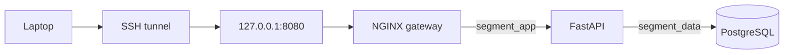

# Docker Segmented Microservice Network

[](https://github.com/TravelReg/docker-segment-lab/actions/workflows/ci.yml)

A Docker networking lab demonstrating how to isolate a gateway, API, and database across separate network zones.

Only the NGINX gateway is published to the host—and only on loopback. The API and PostgreSQL database remain private.

## Architecture



| Service | Networks | Addresses |
|---|---|---|
| Gateway | `segment_edge`, `segment_app` | `172.28.10.10`, `172.28.20.10` |
| API | `segment_app`, `segment_data` | `172.28.20.20`, `172.28.30.20` |
| Database | `segment_data` | `172.28.30.30` |

`segment_app` and `segment_data` are internal Docker networks.

## Enforced network policy

| Path | Result |
|---|---:|
| Host loopback → Gateway | Allowed |
| Gateway → API | Allowed |
| API → PostgreSQL | Allowed |
| Edge network → API | Blocked |
| Edge network → PostgreSQL | Blocked |
| Gateway → PostgreSQL | Blocked |
| Application network → PostgreSQL | Blocked |
| Host → API or PostgreSQL | Blocked |

The repository includes automated positive and negative connectivity tests for these paths.

## Security features

- Three purpose-specific Docker bridge networks
- API and database have no published host ports
- Gateway bound to `127.0.0.1:8080`
- Internal application and data networks
- Non-root API and NGINX containers
- Database password loaded from an ignored secret file
- Container images pinned to immutable SHA-256 digests
- Locked Python dependencies
- Container health checks
- GitHub Actions verification
- Dependabot update monitoring

## Quick start

Requirements:

- Linux
- Docker Engine
- Docker Compose
- OpenSSL
- Bash

Clone and configure the project:

```bash
git clone https://github.com/TravelReg/docker-segment-lab.git
cd docker-segment-lab

cp .env.example .env
mkdir -p secrets

(
    umask 077
    openssl rand -base64 32 > secrets/db_password.txt
)
```

When running as `root` with `APP_UID=10001`:

```bash
chown 10001:10001 secrets/db_password.txt
chmod 600 secrets/db_password.txt
```

Build and start:

```bash
docker compose config --quiet
docker compose up -d --build --wait --wait-timeout 120
docker compose ps
```

Expected host exposure:

```text
gateway    127.0.0.1:8080->8080/tcp
api        8000/tcp
database   5432/tcp
```

Only the gateway has a host-side binding.

## Access through SSH

The gateway is not exposed on the Droplet’s public interface. Forward it through SSH:

```bash
ssh -N \
  -L 8080:127.0.0.1:8080 \
  root@YOUR_DROPLET_IP
```

Then open:

```text
http://127.0.0.1:8080
```

For Termius, use the saved Droplet as the intermediate host and forward local `127.0.0.1:8080` to destination `127.0.0.1:8080`.

## Automated verification

Run:

```bash
make test
```

A successful run produces:

```text
Passed:  22
Failed:  0
Skipped: 3

Network verification passed.
```

The tests verify service health, published ports, allowed communication paths, blocked cross-network paths, DNS isolation, and gateway proxying.

Optional public-egress checks:

```bash
CHECK_EGRESS=1 make test
```

## Useful commands

```bash
# View containers
docker compose ps

# Follow logs
docker compose logs --follow

# Check Python dependencies
docker compose exec -T api python -m pip check

# Stop containers
docker compose down
```

The services use fixed container addresses. Use `docker compose exec` rather than `docker compose run` while the stack is running, because a temporary container may attempt to claim an address already in use.

## Scope

This project demonstrates Docker-level network segmentation. It does not replace:

- A host firewall
- Application authentication and authorization
- TLS
- Operating-system hardening
- Isolation from a compromised Docker daemon or host root account

## Project status

Complete and operational on an Ubuntu DigitalOcean Droplet, with SSH-tunneled access and automated GitHub Actions verification.
