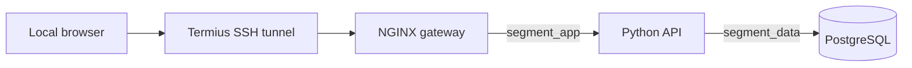

# Architecture

## Request path

## Network membership

| Container | Edge network | Application network | Data network |
|---|---:|---:|---:|
| Gateway | Yes | Yes | No |
| API | No | Yes | Yes |
| Database | No | No | Yes |

The gateway and API are dual-homed containers. Each connects two adjacent network zones.

The gateway is the only service published to the Docker host. The API and database can be reached only through their appropriate Docker networks.
